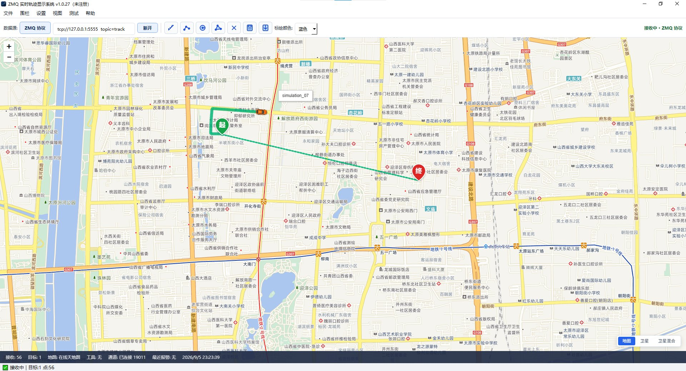

# ZMQ Track Viewer

桌面端 GPS 轨迹实时追踪与可视化软件（Windows x64），基于 PySide6 + 天地图。

## 界面预览

## 主要功能

- **实时多目标追踪**：支持 ZMQ / 串口（NMEA 0183）/ UDP 三种数据源接入，多目标并行显示
- **轨迹可视化**：标记点随航向旋转（飞机 / 火箭 / 船 / 车等图标）、历史轨迹回放
- **电子围栏**：绘制多边形围栏、越界实时报警
- **历史回放**：CSV 轨迹回放、MP4 导出
- **路线模拟**：起点 + 终点 + 途径点路线模拟，单车 / 多车并行发布
- **多底图**：天地图在线 / OSM / 离线瓦片自由切换

## 下载

前往 [Releases](https://github.com/heyPython2026/zmq_track_viewer/releases) 下载最新版本，解压后运行 `ZMQTrackViewer.exe`。

## 授权注册

软件使用需注册授权，注册请联系：**635873431@qq.com**
